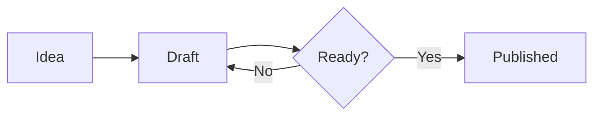
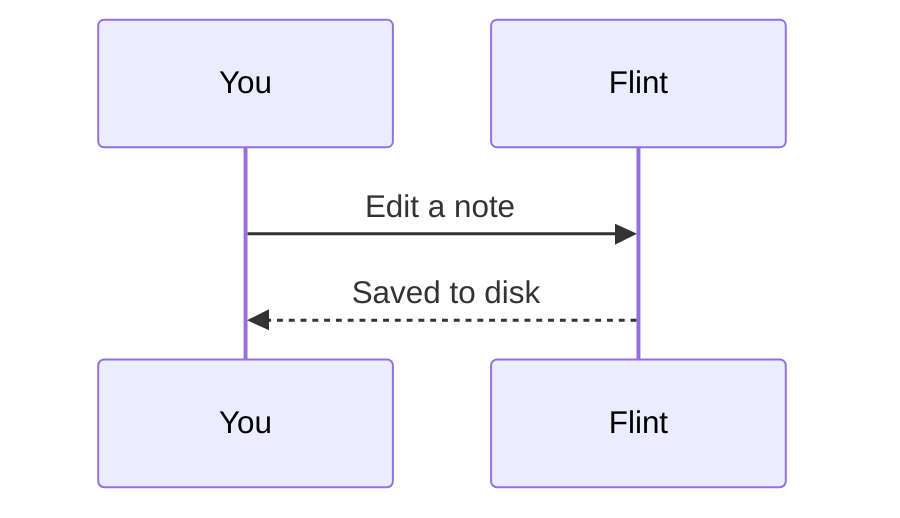
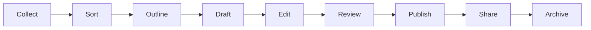

# Rich content

## Images

![[gradient.png]]

Paste a screenshot or drop an image here; it's saved to the folder chosen in Settings → Attachment location. A width: ![[gradient.png|160]]

## Tables

| Feature | Live preview | Reading view |
| ------- | ------------ | ------------ |
| Tables  | ✓            | ✓            |
| Embeds  | ✓            | ✓            |

## Embeds

A whole note, or one section:

![[Projects/Roadmap#Next]]

## Callouts

> [!note]
> A plain callout with a [[Tags|link]].

> [!warning] Careful
> Titles are optional.

> [!tip]- Folded
> Click the title to open it.
>
> - [ ] A task inside a callout

## Tasks

- [ ] Check me here, in the reading view or in an embed
- [x] Done
  - [ ] Nested

## Code

```python
def greet(name):
    return f"Hello {name}"  # hover to copy
```

## Diagrams

Mermaid code blocks render as diagrams. Hover one for its buttons: open it full size (scroll to zoom, drag to move around), copy it as an image, or save it as SVG or PNG in the attachment folder.





A wide one reads better full size:



## Headings fold in the reading view

Hover a heading in the reading view and click the arrow.
